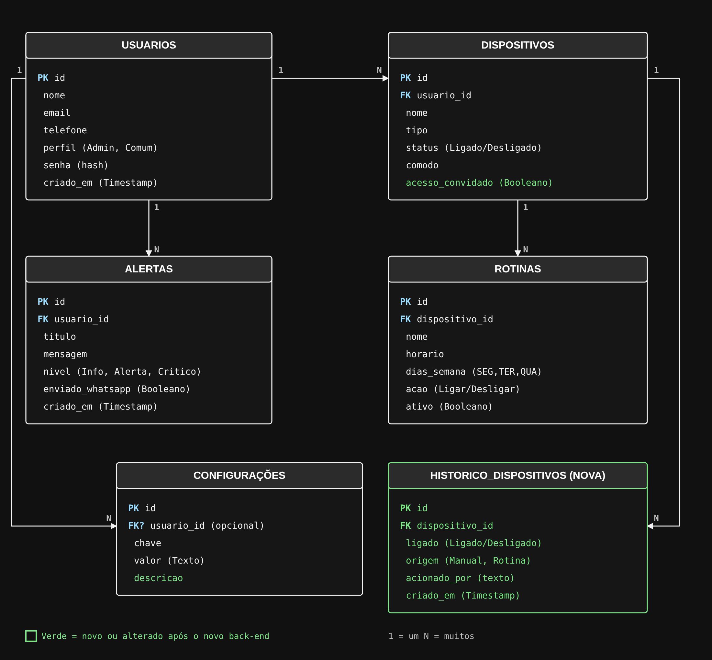
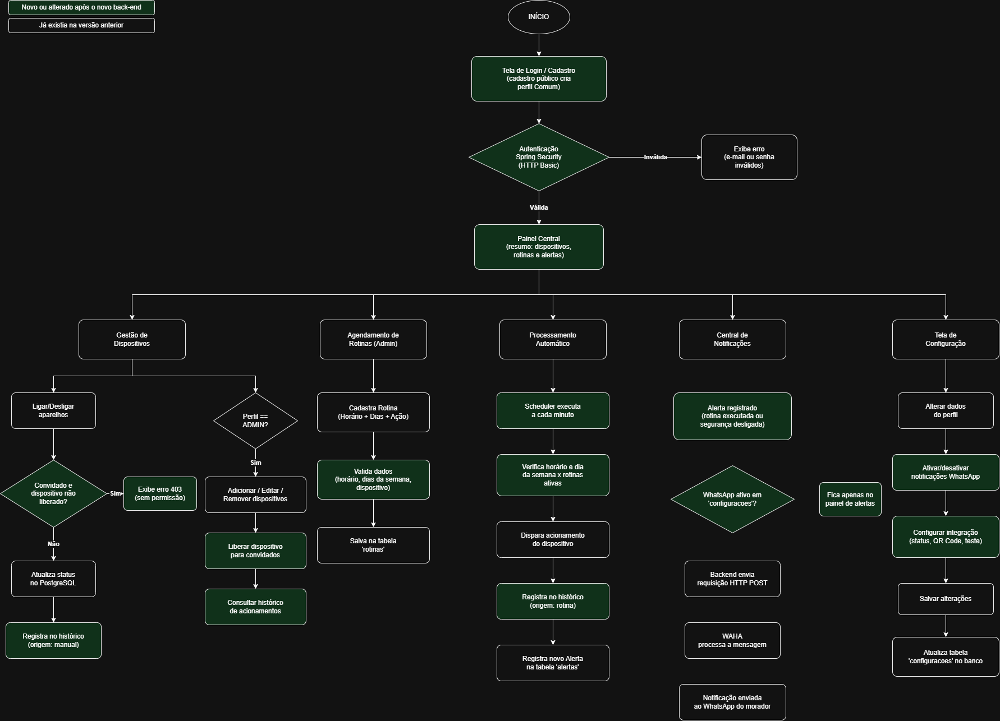

# 🏠 Documentação do Projeto - Casa Inteligente 2050: Mônica

> Painel central de gerenciamento inteligente para residências, com controle de acesso, automação de rotinas e monitoramento de dispositivos em tempo real.

---

## 1. Visão Geral do Produto

O projeto **Mônica** foi concebido para ser o painel central de uma casa inteligente em 2050. O sistema centraliza o cadastro e monitoramento de dispositivos conectados, automatiza rotinas diárias (como iluminação, rega e climatização) e gerencia permissões de acesso diferenciadas entre moradores (administradores) e convidados (usuários comuns).

---

## 2. Escopo e Funcionalidades Principais

### 🔒 Autenticação e Gestão de Acessos
- **Perfil Administrador (Morador):** Acesso total ao sistema, cadastro/remoção de dispositivos, criação e edição de rotinas automatizadas, gestão de usuários e das configurações da central.
- **Perfil Usuário Comum (Convidado):** Acesso limitado ao acionamento pontual (ligar/desligar) dos dispositivos **liberados pelo administrador**, sem acesso a configurações, rotinas, alertas ou histórico.
- **Cadastro público:** qualquer pessoa pode se cadastrar, mas sempre com perfil Comum. Somente um Administrador cria outros Administradores.

### 📱 Gestão de Dispositivos Conectados
- Cadastro, edição, listagem e remoção de dispositivos (iluminação, climatização, irrigação, segurança e outros).
- Visualização do status (ligado/desligado) e do cômodo.
- Liberação individual de cada dispositivo para convidados.
- **Histórico de acionamentos:** cada mudança de estado registra quem acionou (pessoa ou rotina) e quando.

### ⏰ Agendamento e Automação de Rotinas
- Agendamento de rotinas para rega de plantas, iluminação por horário e climatização ambiente, com horário, dias da semana e ação (ligar/desligar).
- Execução automática em segundo plano: um agendador (`@Scheduled`) verifica as rotinas ativas a cada minuto.
- Execução manual imediata de uma rotina ("executar agora"), útil para demonstrações.

### 💬 Notificações e Central de Alertas
- Alertas registrados no painel (níveis `INFO`, `ALERTA` e `CRITICO`).
- Envio das notificações via WhatsApp para os administradores (Evolution API) ao executar rotinas e ao desligar dispositivos de segurança.
- O envio pelo WhatsApp pode ser ligado/desligado nas configurações da central.

### 📊 Painel Central
- Resumo com total de dispositivos, dispositivos ligados, rotinas ativas, alertas das últimas 24 horas e total de usuários.

---

## 3. Arquitetura e Tecnologias (Stack)

### Back-End
- **Linguagem:** Java 17+
- **Framework:** Spring Boot
  - *Spring Web:* Exposição da API RESTful.
  - *Spring Security:* Autenticação HTTP Basic (sem sessão, a cada requisição), senhas com BCrypt e autorização por perfil (`ADMIN` / `COMUM`) com `@PreAuthorize`.
  - *Spring Data JPA:* Mapeamento objeto-relacional e persistência de dados.
  - *Bean Validation:* Validação de tipos e formatos dos dados de entrada.
  - *Spring @Scheduled:* Automação e execução de tarefas agendadas.
- **Organização em camadas (`com.monica.casa`):** `model`, `repository`, `service`, `controller`, `dto`, `exception`, `config`, `security`, `scheduler` e `util`.

### Front-End
- **Biblioteca/Framework:** React (ou Vue.js)
- **Estilização:** Tailwind CSS
- **Consumo:** Cliente HTTP (Axios/Fetch) consumindo a API REST.

### Banco de Dados & Infraestrutura
- **Banco de Dados:** PostgreSQL (Banco relacional), criado pelo script `database/init.sql`.
- **Containerização:** Docker & Docker Compose (PostgreSQL + Evolution API).
- **Integração Externa:** Evolution API (envio de mensagens via WhatsApp rodando via Docker).

---

## 4. Requisitos do Sistema

### Requisitos Funcionais (RF)
- **RF01:** O sistema deve permitir o cadastro e login de usuários com identificação de perfis (Admin e Comum).
- **RF02:** O sistema deve permitir que o Admin cadastre, edite, liste e remova dispositivos conectados.
- **RF03:** O sistema deve permitir o agendamento de rotinas automatizadas pelo perfil Admin.
- **RF04:** O sistema deve restringir o acesso a recursos administrativos quando um Usuário Comum estiver autenticado.
- **RF05:** O sistema deve disparar notificações via WhatsApp para o Admin ao acionar rotinas estratégicas.
- **RF06:** O sistema deve registrar o histórico de acionamentos de cada dispositivo (estado, origem manual ou rotina, responsável e data/hora).
- **RF07:** O Admin deve poder liberar dispositivos específicos para uso de convidados; o Usuário Comum só pode acioná-los quando liberados.
- **RF08:** O sistema deve executar automaticamente as rotinas ativas no horário e nos dias da semana configurados.
- **RF09:** O Admin deve poder gerenciar usuários e as configurações da central (inclusive ligar/desligar as notificações por WhatsApp).

### Requisitos Não-Funcionais (RNF)
- **RNF01:** A interface deve ser responsiva e intuitiva (UX/UI centrada no usuário morador).
- **RNF02:** As senhas de acesso devem ser salvas no banco de dados de forma criptografada (BCrypt).
- **RNF03:** Os dados devem ser persistidos em banco de dados relacional PostgreSQL.
- **RNF04:** A aplicação deve validar os tipos e formatos dos dados de entrada antes de processar as requisições, devolvendo mensagens de erro claras por campo.
- **RNF05:** Falhas na integração com o WhatsApp não devem interromper o funcionamento da casa (o envio é feito em "melhor esforço").
- **RNF06:** A API deve aceitar requisições do front-end (CORS configurável).

---

## 5. Modelagem de Dados (DER / ERD)

*Arquivo editável: [`database/modelagem.drawio`](./database/modelagem.drawio) (abrir em app.diagrams.net).*

### Entidades e Atributos

1. **`usuarios`**: Representa os usuários da plataforma e os seus privilégios de acesso.
   * `id` (BIGSERIAL, Chave Primária)
   * `nome` (VARCHAR(100), Não Nulo)
   * `email` (VARCHAR(100), Único, Não Nulo)
   * `senha` (VARCHAR(255), Hash BCrypt criptografado, Não Nulo)
   * `telefone` (VARCHAR(20), Único, Não Nulo — *Usado no disparo via Evolution API/WhatsApp; guardado só com dígitos e DDI, ex.: 5511999999999*)
   * `perfil` (VARCHAR(20), Não Nulo — *`ADMIN` ou `COMUM`*)
   * `criado_em` (TIMESTAMP, Padrão `CURRENT_TIMESTAMP`)

2. **`dispositivos`**: Equipamentos inteligentes cadastrados na residência.
   * `id` (BIGSERIAL, Chave Primária)
   * `nome` (VARCHAR(100), Não Nulo — *Ex: "Luz da Sala", "Rega do Jardim"*)
   * `tipo` (VARCHAR(50), Não Nulo — *`ILUMINACAO`, `CLIMATIZACAO`, `IRRIGACAO`, `SEGURANCA`, `OUTRO`*)
   * `status` (BOOLEAN, Padrão `FALSE` — *`true` para Ligado, `false` para Desligado*)
   * `comodo` (VARCHAR(50) — *Ex: "Jardim", "Cozinha"*)
   * `acesso_convidado` (BOOLEAN, Não Nulo, Padrão `FALSE` — ***novo:*** *`true` quando o dispositivo é liberado para usuários Comuns*)
   * `usuario_id` (BIGINT, Chave Estrangeira `usuarios(id)` — *administrador que cadastrou*)

3. **`rotinas`**: Regras e agendamentos automáticos executados pelo backend (`@Scheduled`).
   * `id` (BIGSERIAL, Chave Primária)
   * `nome` (VARCHAR(100), Não Nulo — *Ex: "Rega Matinal", "Climatização Noite"*)
   * `horario` (TIME, Não Nulo — *precisão de minutos*)
   * `dias_semana` (VARCHAR(50), Não Nulo — *Ex: "SEG,TER,QUA,QUI,SEX"*)
   * `acao` (VARCHAR(20), Não Nulo — *`LIGAR` ou `DESLIGAR`*)
   * `ativo` (BOOLEAN, Padrão `TRUE`)
   * `dispositivo_id` (BIGINT, Chave Estrangeira `dispositivos(id)`)

4. **`alertas`**: Registros visuais no painel central e histórico de notificações enviadas via WhatsApp.
   * `id` (BIGSERIAL, Chave Primária)
   * `titulo` (VARCHAR(100), Não Nulo)
   * `mensagem` (TEXT, Não Nulo)
   * `nivel` (VARCHAR(20), Não Nulo — *`INFO`, `ALERTA`, `CRITICO`*)
   * `enviado_whatsapp` (BOOLEAN, Padrão `FALSE`)
   * `criado_em` (TIMESTAMP, Padrão `CURRENT_TIMESTAMP`)
   * `usuario_id` (BIGINT, Chave Estrangeira `usuarios(id)` — *destinatário do alerta*)

5. **`configuracoes`**: Guarda as preferências do sistema e dados da casa.
   * `id` (BIGSERIAL, Chave Primária)
   * `chave` (VARCHAR(100), Único, Não Nulo — *Ex: "NOME_CASA", "NOTIFICACOES_WHATSAPP", "NOTIFICAR_ROTINAS"*)
   * `valor` (TEXT, Não Nulo — *Ex: "Casa Mônica 2050", "true"*)
   * `descricao` (VARCHAR(255) — *explicação da configuração*)
   * `usuario_id` (BIGINT, Chave Estrangeira `usuarios(id)` — *Opcional, caso a configuração seja por usuário*)

6. **`historico_dispositivos`** ***(nova)***: Registro de cada mudança de estado de um dispositivo (histórico de uso).
   * `id` (BIGSERIAL, Chave Primária)
   * `dispositivo_id` (BIGINT, Chave Estrangeira `dispositivos(id)`, Não Nulo)
   * `ligado` (BOOLEAN, Não Nulo — *estado assumido: `true` ligou, `false` desligou*)
   * `origem` (VARCHAR(20), Não Nulo — *`MANUAL` ou `ROTINA`*)
   * `acionado_por` (VARCHAR(150) — *nome de quem acionou ou "Rotina: nome"; guardado como texto para o registro sobreviver à remoção do usuário*)
   * `criado_em` (TIMESTAMP, Não Nulo, Padrão `CURRENT_TIMESTAMP`)

### Relacionamentos
- `usuarios` 1:N `dispositivos` · `usuarios` 1:N `alertas` · `usuarios` 1:N `configuracoes` (opcional)
- `dispositivos` 1:N `rotinas` · `dispositivos` 1:N `historico_dispositivos`

---

## 6. Fluxograma do Sistema

*Arquivo editável: [`architecture/fluxograma.drawio`](./architecture/fluxograma.drawio).*

---

## 7. Regras de Negócio

- Um dispositivo só registra histórico quando o estado **realmente muda** (ligar algo que já está ligado não gera registro).
- Convidado (Comum) só enxerga e aciona dispositivos com `acesso_convidado = true`; nos demais, recebe erro 403.
- Rotinas, alertas, histórico, usuários, configurações e a integração com o WhatsApp são exclusivos do Administrador.
- Ao desligar um dispositivo do tipo `SEGURANCA`, todos os administradores recebem um alerta de nível `ALERTA`.
- Ao executar uma rotina, os administradores recebem um alerta `INFO` (se `NOTIFICAR_ROTINAS` estiver ligado). O envio ao WhatsApp só ocorre se `NOTIFICACOES_WHATSAPP` estiver ligado.
- A casa sempre mantém ao menos um Administrador: não é possível remover ou rebaixar o último.
- Um usuário não pode remover a própria conta, nem ser removido enquanto tiver dispositivos cadastrados em seu nome.
- Dias da semana aceitos nas rotinas: `SEG, TER, QUA, QUI, SEX, SAB, DOM`.
- Na primeira execução, o sistema cria um administrador inicial (configurável em `application.properties`) e as configurações padrão.

---

## 8. API REST

Autenticação: **HTTP Basic** (e-mail e senha). Erros seguem o formato `{status, erro, mensagem, caminho, campos}`.

| Método | Rota | Quem acessa | Descrição |
|---|---|---|---|
| POST | `/api/auth/register` | Público | Cadastro (perfil Comum) |
| GET | `/api/auth/me` | Autenticado | Dados e perfil do usuário logado |
| GET | `/api/dashboard` | Autenticado | Resumo do painel |
| GET | `/api/dispositivos` | Admin e Comum* | Lista dispositivos (*Comum: só os liberados*) |
| GET | `/api/dispositivos/{id}` | Admin e Comum* | Detalhe do dispositivo |
| POST | `/api/dispositivos` | Admin | Cadastra dispositivo |
| PUT | `/api/dispositivos/{id}` | Admin | Edita dispositivo |
| DELETE | `/api/dispositivos/{id}` | Admin | Remove dispositivo (e suas rotinas/histórico) |
| PATCH | `/api/dispositivos/{id}/status` | Admin e Comum* | Liga/desliga: `{"ligado": true}` |
| GET | `/api/dispositivos/{id}/historico` | Admin | Histórico de um dispositivo |
| GET | `/api/dispositivos/historico` | Admin | Histórico geral da casa |
| GET/POST | `/api/rotinas` | Admin | Lista / cria rotinas |
| GET/PUT/DELETE | `/api/rotinas/{id}` | Admin | Detalha / edita / remove rotina |
| PATCH | `/api/rotinas/{id}/ativo` | Admin | Ativa ou pausa: `{"ativo": false}` |
| POST | `/api/rotinas/{id}/executar` | Admin | Executa a rotina agora |
| GET | `/api/alertas` | Admin | Central de alertas |
| GET/POST | `/api/admin/usuarios` | Admin | Lista / cria usuários (com perfil) |
| GET/PUT/DELETE | `/api/admin/usuarios/{id}` | Admin | Detalha / edita / remove usuário |
| GET | `/api/admin/configuracoes` | Admin | Lista configurações |
| GET/PUT/DELETE | `/api/admin/configuracoes/{chave}` | Admin | Consulta / cria-atualiza / remove configuração |
| GET | `/api/admin/whatsapp/status` | Admin | Estado da conexão do WhatsApp |
| POST | `/api/admin/whatsapp/instancia` | Admin | Cria a instância na Evolution API |
| GET | `/api/admin/whatsapp/qrcode` | Admin | QR Code para parear o WhatsApp |
| POST | `/api/admin/whatsapp/teste` | Admin | Envia mensagem de teste ao admin logado |

---

## 9. Configuração e Execução

1. `docker compose up -d` — sobe o PostgreSQL (o `init.sql` cria o schema e o banco da Evolution API) e a Evolution API (porta 8081).
   *Se o volume do banco já existia, recrie-o com `docker compose down -v` para aplicar o `init.sql` atualizado.*
2. `cd backend/casa && ./mvnw spring-boot:run` — API em `http://localhost:8080`.
3. Ajuste em `backend/casa/src/main/resources/application.properties`:
   - `monica.admin.*`: e-mail, senha e **telefone do administrador inicial** (o telefone recebe os alertas).
   - `evolution.*`: URL, chave (`AUTHENTICATION_API_KEY` do `docker-compose.yml`) e nome da instância; `evolution.enabled=false` desliga o envio.
   - `monica.cors.allowed-origins`: endereços do front-end.
   - `monica.timezone`: fuso usado pelo agendador (padrão `America/Sao_Paulo`).
4. Testes automatizados: `./mvnw test` (usam banco em memória, sem Docker).

---

## 10. Próximas Etapas
- [ ] **Protótipo Figma:** Links e previews das telas finalizadas (incluindo histórico, "liberar para convidados", configurações de WhatsApp e dashboard).
- [ ] **Front-end React:** consumo da API descrita na seção 8.
- [ ] **Evolução futura:** autenticação com JWT em substituição ao HTTP Basic